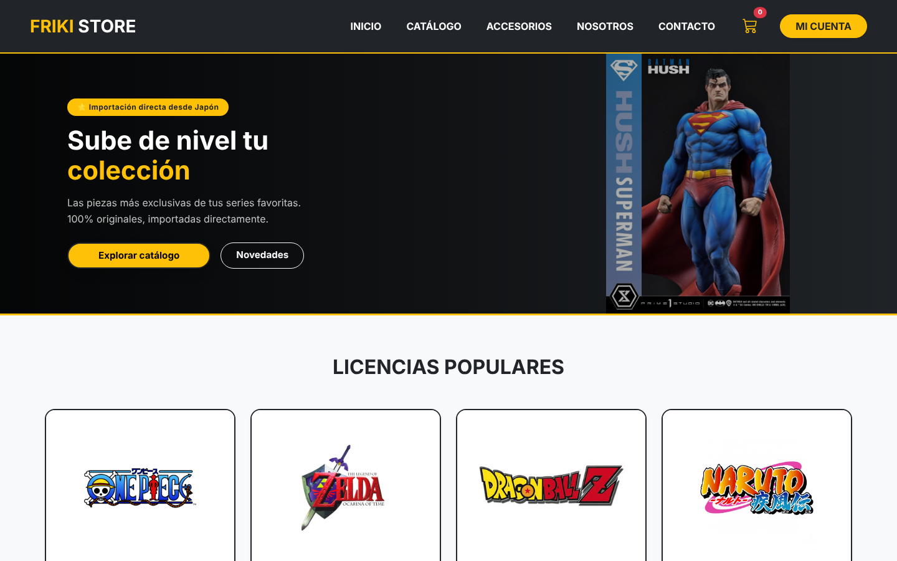
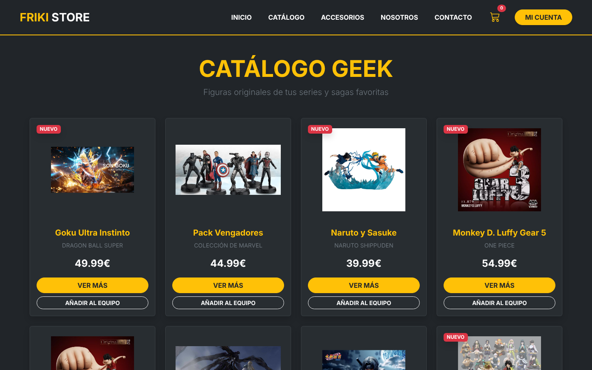
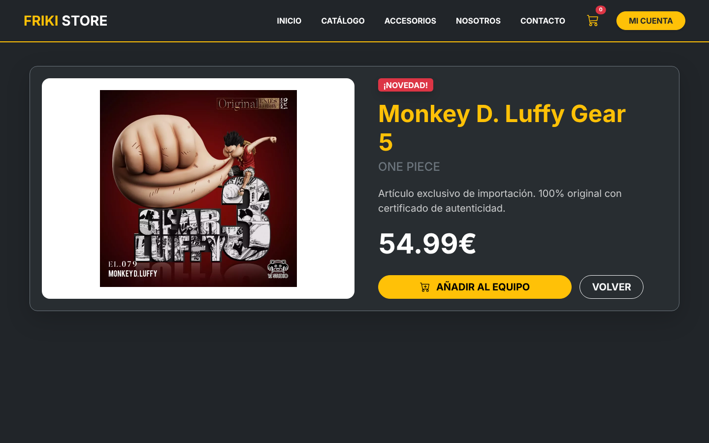
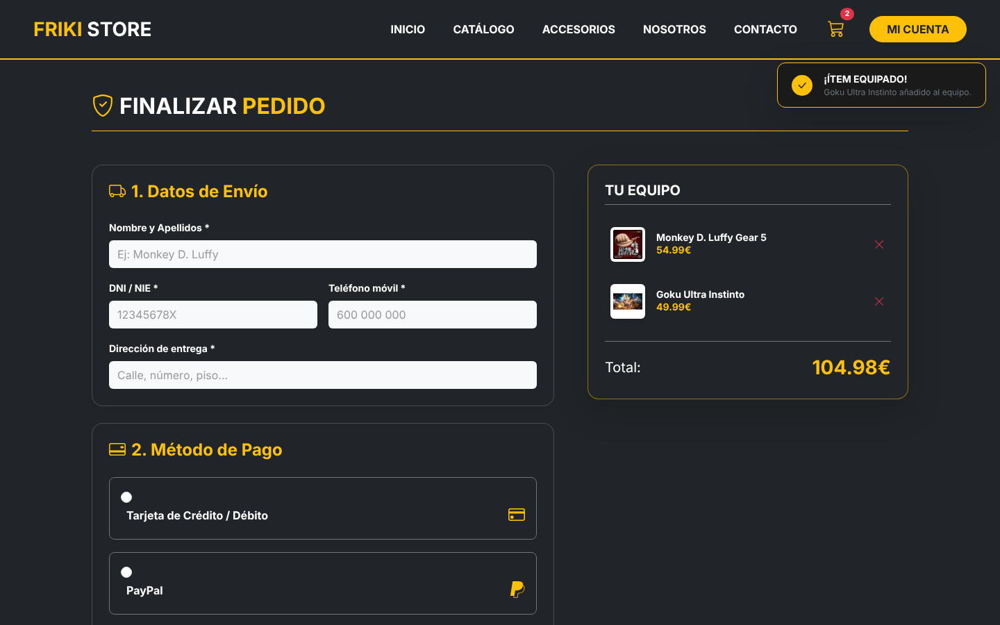
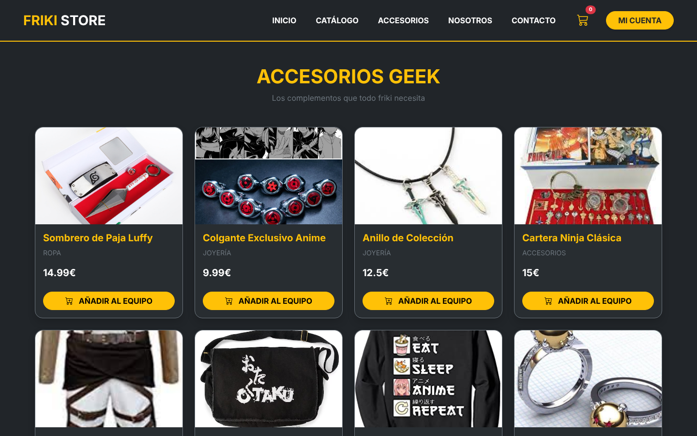
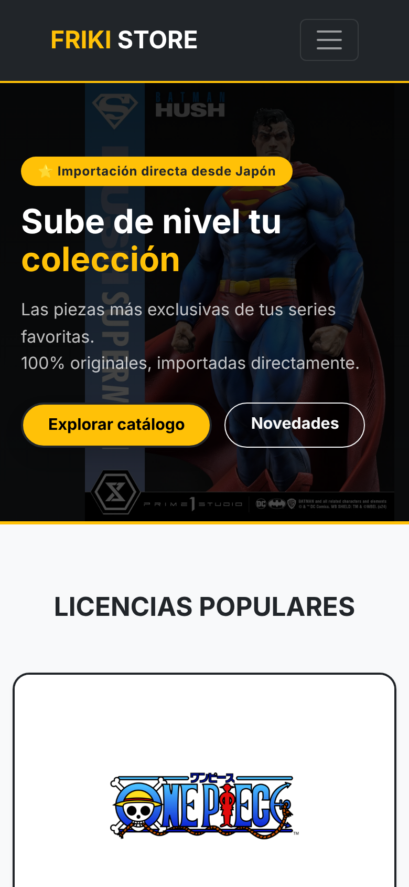

# Friki Store 🛒

Tienda online de figuras de anime, cómics y merchandising friki, desarrollada con **Angular 21** y **Bootstrap 5**.

**Demo:** https://alvarodam87.github.io/frikistore-app/

> Proyecto académico de desarrollo web. Es una tienda ficticia: no se venden productos reales ni se procesan pagos.



## Funcionalidades

- **Catálogo de figuras** cargado desde un JSON con `HttpClient` y un servicio propio (`ProductosService`).
- **Ficha de producto** con ruta dinámica (`/producto/:id`).
- **Página de accesorios** (ropa, joyería, cosplay...) con su propio listado.
- **Carrito** gestionado con **Signals** de Angular: añadir y quitar productos, contador en el menú, total del pedido y aviso emergente al añadir.
- **Proceso de compra** con datos de envío y varios métodos de pago (tarjeta, PayPal, Bizum), solo como simulación.
- **Formularios con validación**: login con *Reactive Forms*, contacto con *Template-driven forms*, y registro.
- **Carga diferida (lazy loading)** de las páginas con `loadComponent` y títulos de pestaña por ruta.
- **Página 404** personalizada para rutas que no existen.
- **Diseño responsive** con Bootstrap y menú adaptado a móvil.

## Capturas

| Catálogo | Ficha de producto |
| --- | --- |
|  |  |

| Carrito y pago | Accesorios |
| --- | --- |
|  |  |

<p align="center"></p>

## Tecnologías

- Angular 21 (componentes *standalone*, Signals, router con *lazy loading*, formularios reactivos y por plantilla)
- TypeScript
- Bootstrap 5 y Bootstrap Icons
- Datos de ejemplo en JSON (`public/assets/data`)
- Despliegue automático en GitHub Pages con GitHub Actions

## Estructura

```
src/app/
├── components/     # navbar y footer
├── pages/          # inicio, catálogo, producto-detalle, accesorios,
│                   # carrito-pago, login, registro, contacto, about-us, not-found
├── services/       # ProductosService (datos) y CartService (carrito con Signals)
├── common/         # interfaces (Producto)
└── app.routes.ts   # rutas de la aplicación
public/assets/
├── data/           # productos.json y accesorios.json
└── images/         # imágenes de productos y portadas
```

## Cómo ejecutarlo

Necesitas Node.js 20 o superior.

```bash
npm install
npm start
```

Abre `http://localhost:4200/`.

Para generar la versión de producción:

```bash
npm run build
```

## Despliegue

Cada vez que se sube un cambio a `main`, el workflow `.github/workflows/deploy.yml` compila la app con `--base-href /frikistore-app/` y la publica en GitHub Pages. También copia `index.html` como `404.html` para que las rutas de Angular funcionen al recargar la página.

## Próximos pasos

- Guardar el carrito en `localStorage` para no perderlo al recargar.
- Conectar con una API real (por ejemplo, Node/Express + MongoDB) para productos, usuarios y pedidos.
- Filtros y buscador en el catálogo.

## Autoría

Proyecto en equipo del ciclo formativo. Repositorio de [Álvaro Moreno](https://github.com/alvarodam87).
